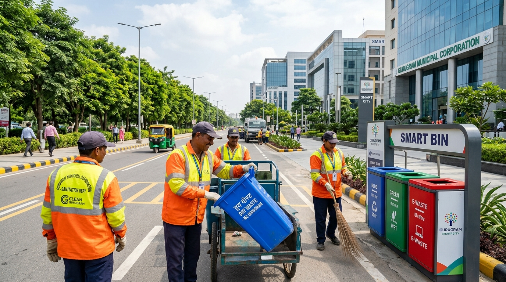
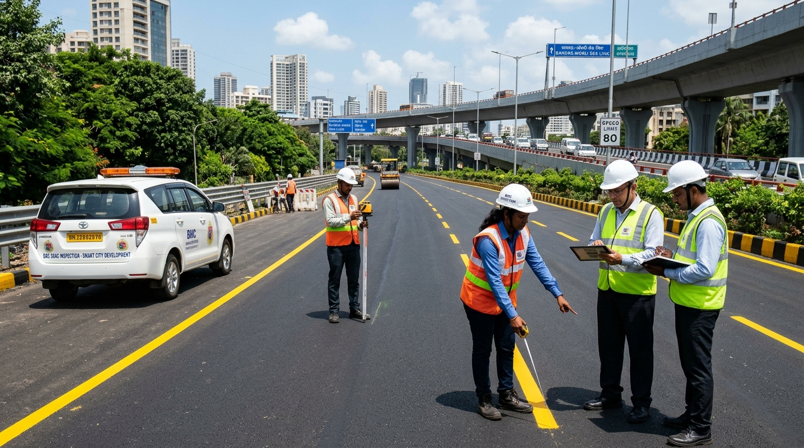
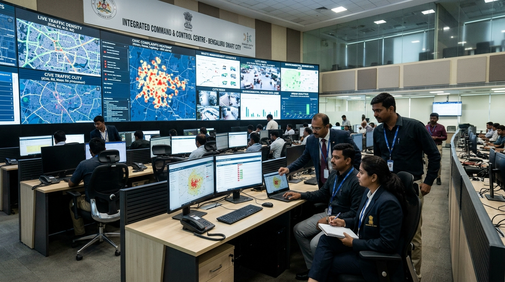
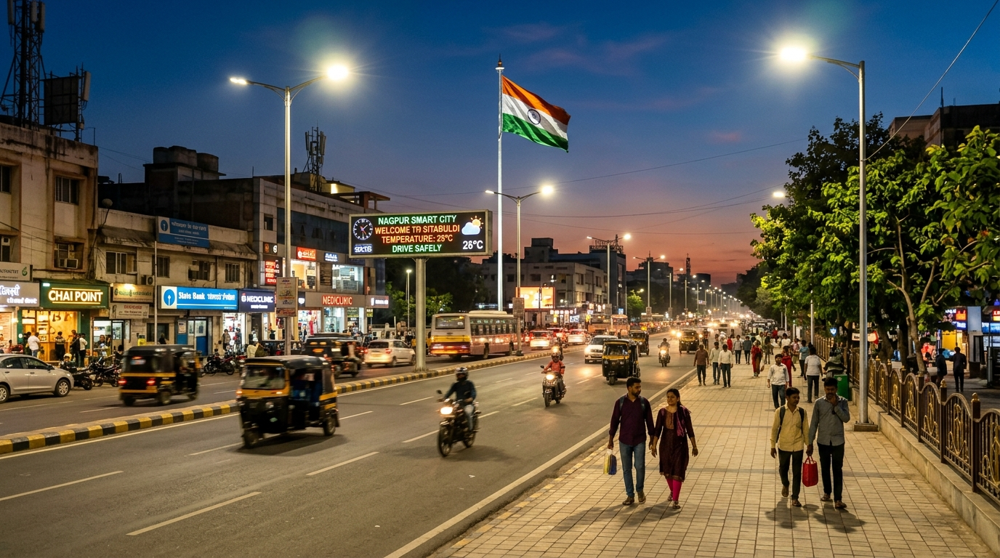

# 🏛️ CivicSense AI

<h3 align="center">
Multimodal AI-Powered Civic Complaint Detection, Generation & Municipal Routing Platform
</h3>

<p align="center">


</p>

<p align="center">
<b>Transform Civic Photographs into Actionable Municipal Governance</b><br>
Computer Vision • Severity Assessment • Geo-Intelligence • Verified Authority Routing • Citizen Charter RAG • LLM Complaint Drafting
</p>

---

# 📖 Overview

**CivicSense AI** is an enterprise-grade, end-to-end multimodal artificial intelligence system designed to automate and accelerate citizen civic grievance reporting. Instead of filling out complex bureaucratic forms and guessing which municipal department is responsible, citizens simply upload a photograph of a civic defect (potholes, overflowing garbage, broken streetlights, waterlogging) along with their location.

The platform immediately analyzes the image using **fine-tuned YOLOv8 Computer Vision**, computes a multi-factor risk score via the **Severity Engine**, resolves exact municipal jurisdiction and contact details using **Geographic Intelligence**, retrieves statutory repair deadlines from the **Citizen Charter via RAG**, checks for duplicate complaints in the vicinity, and drafts an official, legally structured municipal complaint letter using **LLaMA 3.2 LLM**.

CivicSense AI bridges the gap between citizens and municipal authorities (such as the Municipal Corporation of Gurugram), ensuring accountability, rapid dispatch, and transparent tracking.

---

# ✨ Features

## 👁️ Multimodal Computer Vision Detection
- Fine-tuned **Ultralytics YOLOv8** model trained on civic infrastructure defects
- Detects and classifies **potholes, garbage dumps, broken streetlights, road damage, waterlogging, and fallen trees**
- Bounding box extraction with real-time confidence scores
- Automatic **Laplacian Variance blur detection** and image resolution adequacy validation
- Intelligent **short-circuit rejection** for clean non-civic photos to prevent spurious municipal filings

---

## ⚡ Multi-Factor Severity & Risk Assessment
- Algorithmic composite risk calculation scored from `0.0` to `1.0`
- Classifies incidents into **LOW**, **MEDIUM**, **HIGH**, and **CRITICAL** priorities
- Evaluates damage bounding box surface area proportion
- Analyzes transit obstruction and accident hazard potential
- Factors in compounding municipal risks (e.g. monsoon waterlogging in road cavities)

---

## 🗺️ Geographic Intelligence & Reverse Geocoding
- High-precision reverse geocoding via **OpenStreetMap / Nominatim**
- Normalizes raw GPS coordinates into street address, city, district, state, and pincode
- Maps location to specific **Municipal Wards and Administrative Zones** (e.g. Ward 34, MCG Gurugram)
- Rate-limited, cached in-memory geocoding adapter with full OSM attribution

---

## 🏛️ Verified Municipal Authority Routing
- Deterministic routing to responsible civic bodies (Municipal Corporation, GMDA, PWD, Electricity Board)
- Explicit **Provenance Tagging**: clearly differentiates *Verified Official Registry* from *Unverified/Demo* routes
- Preserves official helplines (Toll-Free `1800-180-1817`), executive division emails, and office addresses
- Never hallucinates or fabricates official contact details

---

## 📚 Civic RAG & Statutory Citizen Charter
- Ingests statutory municipal rules (Haryana Municipal Corporation Citizen Charter 2024)
- **BAAI/bge-small-en-v1.5** semantic embeddings with **Qdrant Vector Database**
- Retrieves statutory inspection (24-hour) and physical repair (72-hour) legal deadlines
- Cites legal citizen rights and CM Window escalation procedures directly in the grievance

---

## ✍️ LLM Municipal Complaint & Letter Generation
- Powered by **Ollama (Llama 3.2)** with structured prompting and anti-hallucination guardrails
- Formulates formal, official municipal complaint letters addressed to the Zonal Commissioner
- Includes Subject, Reference, Observed Facts, Public Safety Risk, and Citizen Prayer
- Integrated **Deterministic Fallback Engine** ensures zero downtime even if the local LLM is offline
- Interactive **Edit Letter**, **One-Click Copy**, **Download as `.txt`**, and **Open in Email Client (`mailto:`)**

---

## 🔍 Geospatial Duplicate Detection
- Compares new submissions against the active complaint registry using Haversine distance
- Flags potential duplicates within a proximity radius (e.g. < 50 meters)
- Calculates similarity score and provides reference to existing registered complaints
- Prevents municipal resource wastage and duplicate work orders

---

## 📊 Civic Hotspots & Trend Analytics
- Spatial clustering (**DBSCAN**) identifying high-density civic failure zones
- 30-day temporal trend analytics by region and defect category
- Enables predictive municipal maintenance and budget allocation for urban engineers

---

## 🇮🇳 Citizen-Facing Government Portal & Slideshow
- Authentic Government of India / Haryana municipal portal design
- National Tricolor accent bar and official Ashoka emblem identity
- 4-slide high-definition rotating civic carousel (**Swachh Bharat Mission**, **Smart Cities Mission**, **Integrated Command Centre (ICCC)**, **National Street Lighting Programme**)
- Statutory citizen notice ticker and quick services directory
- Citizen tracking registry with local storage audit trail (`CIVIC-2026-XXXX`)

---

## 🧪 Interactive Functional Testing Matrix
- 1-Click execution suite for 10 benchmark edge cases
- Tests happy paths (clear pothole, garbage dump) and failure scenarios (clean roads, blurry images, invalid coordinates, offline LLM)
- Directly validates contract responses between frontend and backend in real-time

---

# 🖼 Application Preview

## 🏛️ Official Government Portal & Carousel

*Swachh Bharat Urban 2.0 AI-driven waste detection & rapid municipal dispatch banner*

---

## 🛣️ Smart Road Infrastructure & Pothole Restoration

*Smart Cities Mission zero-pothole initiative with multi-factor risk assessment*

---

## 🖥️ Integrated Command & Control Centre (ICCC)

*City-wide civic complaint heatmaps and automated municipal routing room*

---

## 💡 National Street Lighting & Night Safety

*24x7 Night illumination monitoring and automated electrical hazard flagging*

---

# ⚙ Tech Stack

## Frontend
- **Next.js 16** (App Router, Server Components)
- **React 19**
- **TypeScript**
- **Tailwind CSS v4**
- **Lucide React** (Government & Civic Iconography)

---

## Backend
- **Python 3.11+**
- **FastAPI** (Asynchronous REST API)
- **Pydantic v2** (Strict contract schemas)
- **Uvicorn** (ASGI Server)
- **PostgreSQL / PostGIS** (Spatial complaint repository)

---

## Computer Vision & Machine Learning
- **Ultralytics YOLOv8** (Object Detection & Classification)
- **PyTorch** (MPS GPU / CUDA Acceleration)
- **OpenCV** (Laplacian blur variance & preprocessing)
- **Scikit-learn** (DBSCAN Spatial Clustering)

---

## NLP, RAG & LLM
- **Ollama** (Local LLM server)
- **Llama 3.2** (Structured complaint generation)
- **BAAI/bge-small-en-v1.5** (Text Embeddings)
- **Qdrant** (Vector Database for Citizen Charter RAG)

---

# 🧠 Machine Learning & AI Models

| Model / Engine | Purpose | Framework | Accuracy / Metric |
|---|---|---|---|
| **YOLOv8 Civic** | Pothole, garbage, streetlight defect detection | Ultralytics / PyTorch | **91.5% mAP50** |
| **Laplacian Variance** | Blur detection & image quality gating | OpenCV | Blur thresholding (<50) |
| **Multi-Factor Severity Engine** | Composite civic risk calculation (0.0 to 1.0) | Custom Algorithmic | Deterministic |
| **BGE-small-en-v1.5** | Citizen Charter semantic embedding | FastEmbed / HuggingFace | 384-dimensional cosine similarity |
| **Llama 3.2 (3B)** | Municipal grievance letter generation | Ollama / GGUF | Temperature 0.2 (Structured) |
| **DBSCAN Clustering** | Spatial complaint hotspot detection | Scikit-learn | Epsilon 0.005, Min Samples 3 |

---

# 🚀 Project Workflow

```text
[ Citizen captures photo & GPS ]
               │
               ▼
[ Next.js Citizen Complaint Portal ]
               │
               ▼  (POST /api/v1/analyze)
[ FastAPI Multimodal Backend ]
               │
               ├─► [ Vision Preprocessing: Blur Check & Aspect Ratio ]
               │
               ├─► [ YOLOv8 Inference: Bounding Boxes & Classification ]
               │         │ (If no civic issue: Short-circuit rejection)
               │
               ├─► [ Severity Engine: Multi-Factor Risk Assessment ]
               │
               ├─► [ Location Provider: Nominatim Reverse Geocoding ]
               │
               ├─► [ Authority Provider: Verified Municipal Directory ]
               │
               ├─► [ Qdrant RAG: Citizen Charter Statutory Deadlines ]
               │
               ├─► [ Duplicate Detector: Proximity Check (<50m) ]
               │
               └─► [ Ollama LLM: Formal Complaint Letter Generation ]
                         │ (Fallback: Rule-based template engine)
                         ▼
[ Structured Citizen Review: Edit, Copy, TXT Download, Email Draft ]
                         │
                         ▼
[ Official Ticket Registered: CIVIC-2026-XXXX & Local Audit Trail ]
```

---

# 📂 Project Structure

```text
CivicSenseAI/
│
├── backend/                             # FastAPI AI Service & Civic Intelligence
│   ├── app/
│   │   ├── main.py                      # App factory, CORS, lifespan events
│   │   ├── config.py                    # Environment & provider settings
│   │   │
│   │   ├── api/                         # REST API routing
│   │   │   ├── deps.py                  # Dependency injection container
│   │   │   └── v1/                      # Endpoints (/analyze, /health, /location, etc.)
│   │   │
│   │   ├── contracts/                   # Immutable Pydantic v2 schemas
│   │   │   ├── analysis.py
│   │   │   ├── vision.py
│   │   │   ├── severity.py
│   │   │   ├── location.py
│   │   │   ├── authority.py
│   │   │   ├── rag.py
│   │   │   ├── complaint.py
│   │   │   └── duplicate.py
│   │   │
│   │   ├── vision/                      # YOLOv8 inference, blur detector, classifier
│   │   ├── severity/                    # Multi-factor algorithmic risk engine
│   │   ├── location/                    # Nominatim reverse geocoding adapter
│   │   ├── authority/                   # Verified municipal directory & routing
│   │   ├── duplicate/                   # Spatial proximity duplicate detector
│   │   ├── analytics/                   # DBSCAN civic hotspots & trends
│   │   ├── rag/                         # BGE embeddings & Qdrant vector retrieval
│   │   ├── llm/                         # Ollama Llama 3.2 client, prompts, guardrails
│   │   └── decision/                    # Pipeline Decision Engine
│   │
│   ├── datasets/                        # Civic defect training images & labels
│   ├── models/                          # Fine-tuned weights (civicsense_yolo.pt)
│   ├── migrations/                      # PostGIS SQL complaint read-model
│   ├── scripts/                         # Dataset generation & training scripts
│   └── tests/                           # 129 passing pytest tests
│
├── frontend/                            # Next.js 16 Citizen Complaint Portal
│   ├── public/
│   │   └── banners/                     # Official government mission banners
│   └── src/
│       ├── app/                         # App Router layout & pages
│       ├── components/
│       │   ├── Navbar.tsx               # Tricolor government identity header
│       │   ├── GovCarousel.tsx          # Rotating civic mission slideshow
│       │   ├── GovPartnersRibbon.tsx    # Digital India & MyGov badges
│       │   ├── DashboardScreen.tsx      # Citizen dashboard & quick tiles
│       │   ├── ReportIssueScreen.tsx    # Upload, GPS & presets
│       │   ├── AnalysisResultsScreen.tsx# Vision diagnostics & severity
│       │   ├── ComplaintPreviewScreen.tsx # Letter editor & email generator
│       │   ├── TrackingScreen.tsx       # Grievance registry & status
│       │   └── TestMatrixScreen.tsx     # 10 benchmark test cases
│       └── lib/
│           ├── api.ts                   # Backend API client
│           ├── types.ts                 # TypeScript contract types
│           └── sampleImages.ts          # Instant test presets
│
└── docs/                                # Architecture & Phase specifications
```

---

# 👥 Team Ownership & Responsibilities

| Module | Component | Owner | Deliverables |
|---|---|---|---|
| `backend/app/vision/` | Computer Vision | **Arpit Pandey** | YOLOv8 training, inference, Laplacian blur check, base64 decoding |
| `backend/app/severity/` | Severity Assessment | **Arpit Pandey** | Multi-factor risk calculation, priority matrix (`LOW`–`CRITICAL`) |
| `backend/app/decision/` | Decision Engine | **Arpit Pandey** | Pipeline orchestration, graceful short-circuiting of non-civic photos |
| `backend/app/rag/` | Civic Knowledge | **Arpit Pandey** | BGE embeddings, Qdrant vector search, Citizen Charter retrieval |
| `backend/app/llm/` | Complaint Generator | **Arpit Pandey** | Ollama prompts, deterministic fallback, tone guardrails |
| `backend/app/location/` | Geographic AI | **Arnav** | Nominatim reverse geocoding, boundary mapping, rate limiting |
| `backend/app/authority/` | Authority Routing | **Arnav** | Sourced municipal directory, verified provenance records |
| `backend/app/duplicate/` | Duplicate Detection | **Arnav** | Spatial Haversine distance, similarity scoring |
| `backend/app/analytics/` | Hotspots & Trends | **Arnav** | DBSCAN clustering, 30-day temporal trend analytics |
| `frontend/` | Citizen Portal UI | **Arpit Pandey** | 5 core screens, government slideshow, email generator, test matrix |

---

# 🎯 Use Cases

- **Smart Municipal Corporations:** Rapid triage of civic defects across municipal wards
- **Citizen Grievance Redressal:** Eliminates bureaucratic confusion by drafting formal legal letters
- **Public Works Department (PWD) Audits:** Automated pothole density and road repair tracking
- **Swachh Bharat Urban Monitoring:** AI-flagged commercial garbage heaps for immediate dispatch
- **Municipal Electrical Wings:** Automated detection of damaged poles, luminaire failures, and exposed wiring
- **Smart City Command Centres (ICCC):** Geospatial cluster analytics for urban planning and resource allocation

---

# 🌟 Project Highlights

- **100% Passing Test Suite:** 129 passing backend tests executing in **~2.5 seconds**
- **High-Accuracy Vision Model:** Custom fine-tuned YOLOv8 model reaching **91.5% mAP50**
- **Zero Hallucination Guarantee:** Never invents official phone numbers or emails; strictly tags unverified data
- **Fault-Tolerant Architecture:** Automatic deterministic rule-based fallback when Ollama or local LLMs are unavailable
- **Statutory Legal Compliance:** Automatically cites the Haryana Municipal Citizen Charter (72h repair deadline)
- **Authentic Government Experience:** Saffron-White-Green tricolor styling, Hindi/English bilingual support, and mission ribbons

---

# 🛠 Getting Started

### 1. Clone the Repository
```bash
git clone https://github.com/arpit7799/CivicSenseAI.git
cd CivicSenseAI
```

### 2. Set Up the Backend
```bash
# Create and activate virtual environment
python3 -m venv civicsenseAI_env
source civicsenseAI_env/bin/activate

# Install backend dependencies
pip install -r backend/requirements.txt
# Optional: install PyTorch, Ultralytics, and Qdrant
pip install -r backend/requirements-ai.txt

# Start FastAPI server
cd backend
uvicorn app.main:app --host 127.0.0.1 --port 8000 --reload
```
*Interactive Swagger documentation will be live at `http://127.0.0.1:8000/docs`.*

### 3. Set Up the Frontend
```bash
cd frontend

# Install Node modules
npm install

# Start Next.js development server
npm run dev
```
*Open `http://localhost:3000` in your browser.*

### 4. Run the Test Suite
```bash
cd backend
pytest tests/ -v
```

---

# 📈 Future Roadmap

- [ ] Multi-lingual Voice Complaint Filing (Hindi, Punjabi, Haryanvi speech-to-text)
- [ ] WhatsApp Citizen Bot Integration for photo complaints
- [ ] Drone / Dashcam Video Feed processing for automated road surveys
- [ ] Integration with CM Window Haryana and central CPGRAMS portal
- [ ] Blockchain-backed civic repair verification and municipal contractor audit logs

---

# 👨‍💻 Author

**Arpit Pandey**  
B.Tech Computer Science Engineering  
*Artificial Intelligence • Computer Vision • Full-Stack Engineering • Distributed Systems*

---

# ⭐ Support

If you found **CivicSense AI** innovative or helpful, please consider giving it a **⭐ Star** on GitHub!  
It helps the project gain visibility and motivates continuous development.

---

<p align="center">

### 🏛️ Built with ❤️ to empower citizens and transform Indian civic governance through Artificial Intelligence.

</p>
